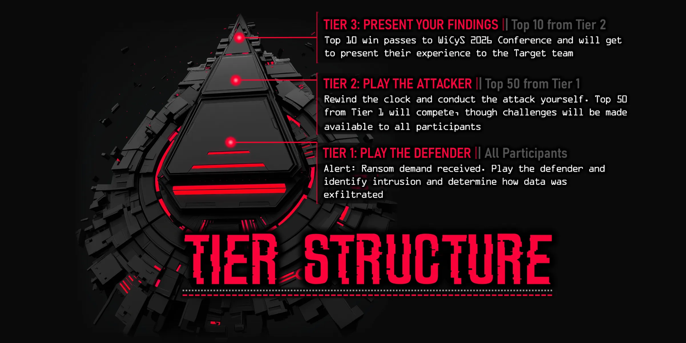

# Target Cyber Defense

This is a writeup for the challenges in the **2025 Target Cyber Defense Challenge**. 

## 📋 Tiers & Details

| Badge | Description |
|-------|-------------|
|  | 🛡 **[Tier 1: Play the Defender](./Tier1/Tier1.md)** • *Rank: 40th* A ransom demand has been received. Identify the intrusion and determine how data was exfiltrated. |
|  | 💥 **[Tier 2: Execute the Attack](./Tier2/Tier2.md)** • *Rank: 34th* Rewind the clock and conduct the attack. |

## Event timeline (2025)

**Tier 1 (Defender)**
- **Active Phase:** July 1 – August 14, 2025
- **Grace Period (Unscored):** August 15 – August 20, 2025

**Tier 2 (Attacker)**
- **Active Phase:** August 21 – September 18, 2025
- **Grace Period (Unscored):** September 19 – October 3, 2025
- *Note: Tier 1 challenges remained accessible during the Tier 2 window for continued attempts.*
