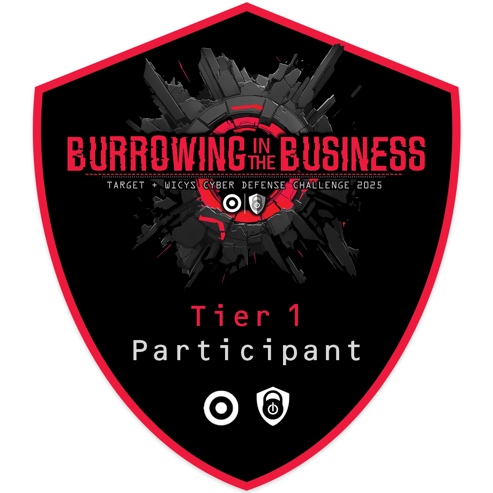
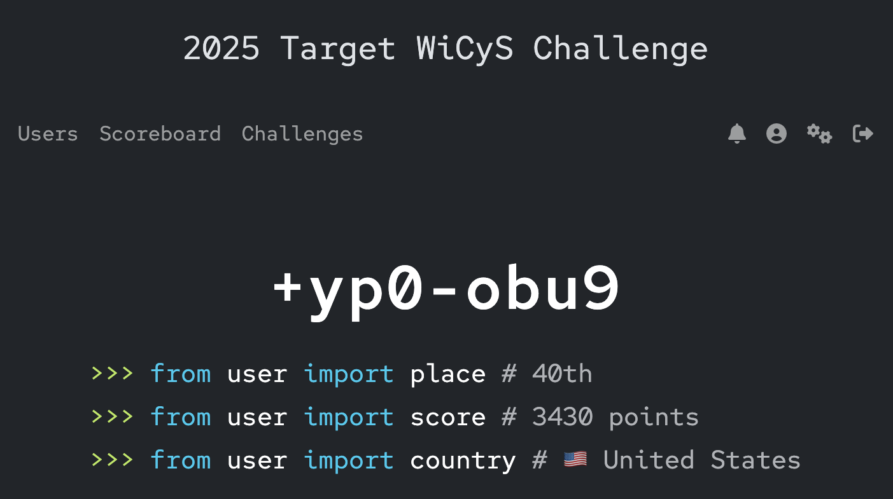

# 🛡 Tier 1: Play the Defender 🛡

**Theme:** A ransom demand has been received. Play the defender to identify the intrusion and determine how data was exfiltrated. 

  

## 🔍 Challenges

- **During Event:** 12 / 13 challenges completed
- **Post-Event:** 1 challenge completed (13/13 total)

| Challenge | Points | Category | Description | Status |
|-----------|:------:|----------|-------------|:------:|
| [D1. Mystery Mail](./D1_Mystery_Mail.md) |  | Email Analysis, Forensics | Identify the sender’s IP from an extortion email | ✅ Solved |
| [D2. Not-so-Simple Mail Protocol](./D2_Not_so_Simple_Mail_Protocol.md) |  | Log Analysis, Email Investigation | Trace the first extortion attempt in logs | ✅ Solved |
| [D3. Ransom Wrangler](./D3_Ransom_Wrangler.md) |  | Social Engineering, Incident Response | Negotiate with the attacker | ✅ Solved |
| [D4. Trout of Office](./D4_Trout_of_Office.md) |  | ⏳ Pending  | ⏳ Pending  | ⏳ Pending |
| [D5. Ahoy, PCAP'n!](./D5_Ahoy_PCAP'n.md) |  | Network Traffic Analysis | Identify which machine is sending stolen data and where it went | ✅ Solved |
| [D6. Smuggled Away!](./D6_Smuggled_Away.md) |  | Network Traffic Analysis, Data Forensics, Cryptography | Discover what data was stolen | ✅ Solved |
| [D7. Endpoints and Exfiltration](./D7_Endpoints_and_Exfiltration.md) |  | Endpoint Forensics, Process Analysis | Identify the process, user, and software used for exfiltration | ✅ Solved |
| [D8. Shadow Commit](./D8_Shadow_Commit.md) |  | Git Forensics, Source Control, Data Analysis | Find malicious IPv4 address within the commit history | ✅ Solved |
| [D9. Logging for Truth](./D9_Logging_for_Truth.md) |  | Log Analysis, Git Forensics | Find the IPv4 address that added the malicious code | ✅ Solved |
| [D10. Backup Break-in](./D10_Backup_Break-in.md) |  | Credential Exposure, Data Discovery, Forensics | Locate the leaked credentials on the backup server | ✅ Solved |
| [D11. Semi-Final Boss](./D11_Semi-Final_Boss.md) |  | Windows Forensics | Find one suspicious registry key | ✅ Solved |
| [D12. Final Boss](./D12_Final_Boss.md) |  | Linux Forensics | Discover an IOC in a disk image | ✅ Solved (Post-Event) |
| [D13. Caught!](./D13_Caught!.md) |  | Survey | Submit the favorite challenge number to complete the CTF | ✅ Solved |

## 🏆 Placement & Points

Achieved **40th place** overall in Tier 1 with **3,430 points**.

  

