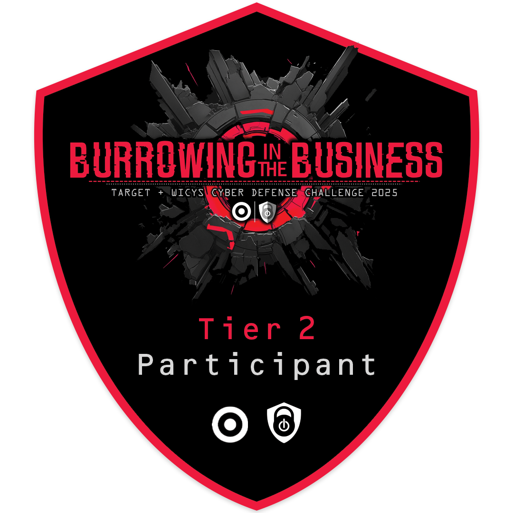
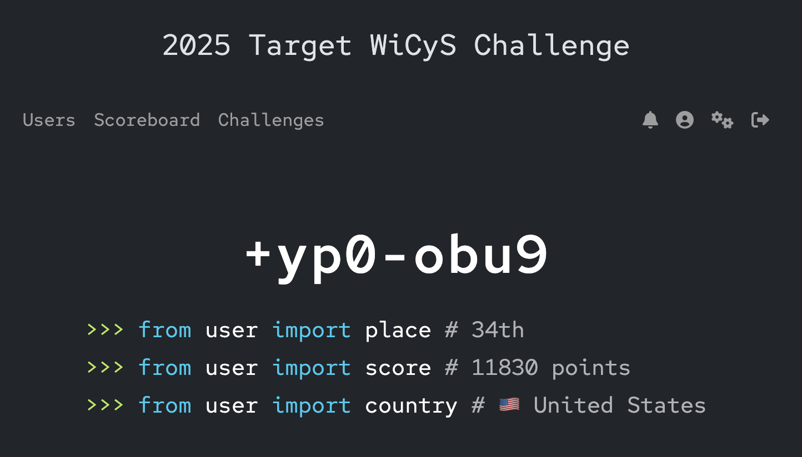

# 💥 Tier 2: Execute the Attack 💥

**Theme:** Rewind the clock and conduct the attack.

  

## 🔍 Challenges

- **Kick Off:** 1 / 1 completed
- **Core Challenges:** 10 / 11 completed

| Challenge | Points | Description | Status |
|-----------|:------:|-------------|:------:|
| **🚀 Kick Off** | | | |
| Congratulations Tier Two Challengers! |  | Enter passphrase posted in Discord to unlock Tier 2 challenges | ✅ Solved |
| **💥 Core Challenges** | | | |
| [O1. Remarkable Resume](./O1_Remarkable_Resume.md) |  | Identify the real job listing and craft a resume that passes all criteria. | ✅ Solved |
| [O2.1. Touchy Templates](./O2.1_Touchy_Templates.md) |  | Confirm SSTI vulnerability and retrieve sensitive data. | ✅ Solved |
| [O2.2. Friendly Files](./O2.2_Friendly_Files.md) |  | Exploit LFI vulnerability to retrieve sensitive data. | ✅ Solved |
| [O2.3. Naughty Network](./O2.3_Naughty_Network.md) |  | Exploit the network diagnostic console to retrieve sensitive data. | ✅ Solved |
| [O3. Escalation of Power](./O3_Escalation_of_Power.md) |  | Exploit a restricted shell to escalate privileges and prove your access. | ✅ Solved |
| [O4.1. Permission Pathways](./O4.1_Permission_Pathways.md) |  | ⏳ Pending | ⏳ Pending |
| O4.2. Lousy LDAP |  | ⏳ Pending | ⏳ Pending |
| O4.3. Suspicious SMB |  | ⏳ Pending | ⏳ Pending |
| O4.4. Legal Lockbox |  | ⏳ Pending | ⏳ Pending |
| O4.5. Mystery Messenger |  | ⏳ Pending | ⏳ Pending |
| O5. Tunnel Vision |  | ⏳ Pending | ❌ DNF |
| **🟨 Bonus Challenge** | | | |
| O6. We're Calling About Your Extension's Warranty |  | ⏳ Pending | ❌ DNF |

## 🏆 Placement & Points

Achieved **34th place** overall in Tier 2 with **11,830 points**.

  

